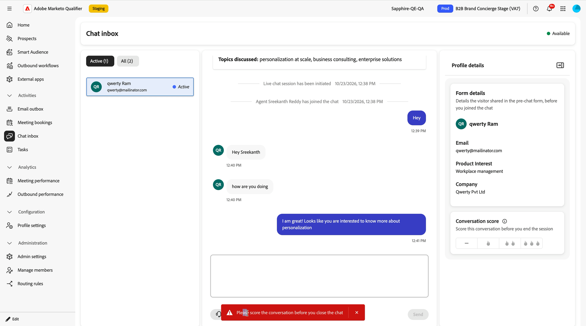

# 聊天收件箱 {#chat-inbox}

当访客请求与某人交谈时，聊天会进入[!DNL Adobe Marketo Qualifier]中的&#x200B;**[!UICONTROL 聊天收件箱]**。 此页面是代表对实时聊天内容的查看：您看到的实时聊天内容、您获得的上下文以及在关闭该页面之前必须执行的操作。

要打开聊天收件箱，请在&#x200B;**[!UICONTROL 活动]**&#x200B;下的左侧面板中选择&#x200B;**[!UICONTROL 聊天收件箱]**。

## 接收聊天 {#receive}

您的状态将显示在收件箱的右上角。 **[!UICONTROL 可用]**&#x200B;表示您现在可以接收聊天。 您的实时聊天可用性小时数决定您是否有资格；请参阅[设置实时聊天可用性](representative-setup.md#chat-availability)。

聊天到达您的方式取决于&#x200B;**[!UICONTROL 实时聊天]**&#x200B;集成上设置的路由类型：

* 使用循环调度时，每个符合条件的代表都会同时收到通知，第一个接受者会进行对话。
* 与直接代理进行聊天时，总是会联系指定的代表。
* 对于自定义路由，聊天会发送给分配给访客匹配的最高优先级规则的代表。

两个选项卡用于组织您的对话：

* **[!UICONTROL 活动]** — 当前正在进行对话。
* **[!UICONTROL 全部]** — 每个对话，包括已结束的对话。

## 接听对话 {#pick-up}

你从不会开始冷的。 在您键入任何内容之前，收件箱会提供访客已向门房告知的所有内容。

{width="800" zoomable="yes"}

| 您所看到的内容 | 它给您的好处 |
| --- | --- |
| **[!UICONTROL 访客对话回顾]** | 访客与门房进行的对话的&#x200B;**[!UICONTROL 摘要]**，以及讨论的&#x200B;**[!UICONTROL 主题]** |
| 对话记录 | 与门房的全面交流（在启动实时聊天的时间点之上） |
| **[!UICONTROL 表单详细信息]** | 访客在您加入前在聊天前表单中输入的内容，如电子邮件、产品兴趣和公司 |

成绩单用两个系统行`Live chat session has been initiated`和`Agent <name> has joined the chat`标记了移交情况，因此您可以始终分辨对话的哪一部分是门卫，哪一部分是您的部分。

在消息框中键入并选择&#x200B;**[!UICONTROL 发送]**&#x200B;以进行回复。

{width="800" zoomable="yes"}

## 为对话评分 {#conversation-score}

在结束聊天之前，请对访客的资格进行评级。 这个分数是由您设置的，您是实际与访客交谈的代表，因此它值得下游信任。

在&#x200B;**[!UICONTROL 个人资料详细信息]**&#x200B;面板的&#x200B;**[!UICONTROL 对话分数]**&#x200B;下，选择一个评级。 短划线表示没有得分，而火焰图标会从最低到最高评价对话。

{width="600" zoomable="yes"}的形式存储在潜在客户记录中

| 选择 | 存储的值 | 含义 |
| --- | --- | --- |
| 短划线 | 0 | 资格最少 |
| 一个火焰 | 1 | 有些合格 |
| 两场火焰 | 2 | 合格 |
| 三声火焰 | 3 | 最符合条件 |

>[!IMPORTANT]
>
>评分是强制性的。 如果您尝试关闭聊天而不对其进行评分，则会显示错误`Please score the conversation before you close the chat`，并且聊天保持打开状态。 在对它评分后，会出现确认消息，您可以关闭聊天。

{width="800" zoomable="yes"}

分数将写入[!DNL Marketo Engage]中的&#x200B;**[!UICONTROL Concierge中的“参与实时聊天”]**&#x200B;活动，在该活动中，分数可用作筛选器和触发器的限制。 使用它来推动重定位、领导评分、个性化和CRM切换。 查看Marketo Engage中的[Brand Concierge数据](marketo-activities.md)。

## 结束聊天 {#end-chat}

选择&#x200B;**[!UICONTROL 结束聊天]**&#x200B;以关闭对话。 访客也可以从自己的侧边结束它，并首先要求他们确认。

当聊天关闭时，其对话状态将记录为以下两个值之一：

* **已结束** — 对话被您或访客蓄意关闭。
* **已丢弃** — 访客离开网站，对话因非活动状态而超时。

>[!NOTE]
>
>实时聊天对话将保留30天。

## 下一步 {#next}

在Marketo Engage中的[Brand Concierge数据](marketo-activities.md)中，查看所有这些内容向营销数据库写回的内容。
