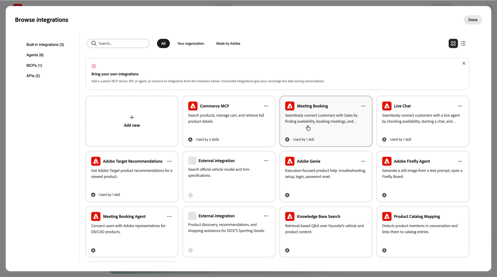

# 激活Live Chat和Meeting预订 {#configure-in-composer}

Composer中必须具备两项功能。 通过&#x200B;**[!UICONTROL Meeting Booking]**&#x200B;和&#x200B;**[!UICONTROL Live Chat]**&#x200B;集成，礼宾员&#x200B;*能够*&#x200B;检查可用性、开始聊天和预订时段。 **[!UICONTROL 移交给销售人员]**&#x200B;技能告知销售人员&#x200B;*何时*&#x200B;使用该能力。

>[!NOTE]
>
>首先完成[在Adobe Marketo Qualifier](representative-setup.md)中设置代表。 集成会检查连接的日历和实时聊天可用性，如果没有它们，则无法激活。

## 连接会议预订集成 {#connect-meeting-booking}

1. 在Composer中，打开您的门房并选择&#x200B;**[!UICONTROL 集成]** > **[!UICONTROL 浏览集成]**。

   **[!UICONTROL Meeting Booking]**&#x200B;和&#x200B;**[!UICONTROL Live Chat]**&#x200B;出现在&#x200B;**[!UICONTROL 内置集成]**&#x200B;下。

   {width="800" zoomable="yes"}

1. 选择&#x200B;**[!UICONTROL 会议预订]**，然后选择&#x200B;**[!UICONTROL 配置]**。

1. 输入名称和说明。

   将集成命名为它在此门房中的操作，如`Meeting booking - US region`或`Meeting booking - round robin`。 您可以连接多个服务器，因此名称是您以后区分它们的方式。

1. 检查日历连接状态。

   该集成验证贵组织中至少有一位代表已连接日历。

   * 如果没有日历，则会显示一条错误消息，指示您在激活会议预订之前至少连接一个日历。 返回[!DNL Adobe Marketo Qualifier]并完成[连接您的日历](representative-setup.md#connect)。
   * 如果至少有一位代表有空，则会显示有代表在场。

1. 选择路由类型： **[!UICONTROL 轮循调度]**、**[!UICONTROL 直接代理]**&#x200B;或&#x200B;**[!UICONTROL 自定义路由]**。

   如果选择&#x200B;**[!UICONTROL 直接代理]**，请选择通过此礼宾处预订的每次会议的接收代表。 如果选择&#x200B;**[!UICONTROL 自定义路由]**，则会应用您在[!DNL Adobe Marketo Qualifier]中构建的路由规则。 有关每个行为的方式，请参阅[将对话路由到代表](routing-rules.md)。

1. 选择&#x200B;**[!UICONTROL 连接]**。

## 连接实时聊天集成 {#connect-live-chat}

1. 在&#x200B;**[!UICONTROL 浏览集成]**&#x200B;中，选择&#x200B;**[!UICONTROL 实时聊天]**，然后选择&#x200B;**[!UICONTROL 配置]**。

1. 输入名称和描述，例如`Live chat - round robin`。

1. 检查实时聊天可用性状态。

   该集成验证至少一位代表已设置了实时聊天可用性。

   * 如果没有，则会显示一条消息，告诉您添加已设置其实时聊天可用性的代表。 返回[!DNL Adobe Marketo Qualifier]并完成[设置实时聊天可用性](representative-setup.md#chat-availability)。
   * 如果至少有一位代表有空，则会显示有代表在场。

1. 选择工艺路线类型。

   Live Chat支持与会议预订相同的三种路由类型。 使用&#x200B;**[!UICONTROL 轮循资源]**，每个符合条件的代表都会立即收到通知，第一个接受的人将开始聊天。

1. 选择&#x200B;**[!UICONTROL 连接]**。

## 激活移交到销售技能 {#activate-skill}

这些集成现在已连接起来，但门房仍需要知道何时提供这些集成。 这是技能的职责。

1. 在Composer中，选择&#x200B;**[!UICONTROL 技能]** > **[!UICONTROL 浏览技能]**，然后选择&#x200B;**[!UICONTROL 移交给销售人员]**。

   详细信息面板显示技能描述、其&#x200B;**[!UICONTROL 使用条件]**&#x200B;条件、推荐的&#x200B;**[!UICONTROL 集成]**&#x200B;和&#x200B;**[!UICONTROL 技能指令]**。

   {width="800" zoomable="yes"}

1. 选择&#x200B;**[!UICONTROL 修改]**。

   {width="800" zoomable="yes"}

1. 查看技能名称和描述，并根据需要对其进行编辑。

1. 查看&#x200B;**[!UICONTROL Use when]**&#x200B;条件。

   这些是触发移交的意图。 该技能附带默认设置：

   | 条件 | 触发器打开 |
   | --- | --- |
   | 顾问访问权限 | 预约或安排会议、开始实时聊天或请求与公司代表联系 |
   | 销售和采购 | 定价、报价、折扣、采购帮助或企业许可 |
   | 竞争比较 | 将您的解决方案与竞争对手的备选解决方案进行比较、区别对待，或从竞争对手平台进行迁移 |
   | 试用和POC访问 | 试用设置、游乐场访问、概念验证或试点 |
   | 合同和许可更改 | 合同续订、期限延长或计划升级 |
   | 采购RFP或RFI | RFP或RFI提交和回复、供应商调查表、采购表或合规性文档 |
   | 演示 | 产品演示或演练 |

   选择&#x200B;**[!UICONTROL 添加条件]**&#x200B;以添加您自己的意图，或删除任何不适用于您的业务的条件。

1. 添加您连接的集成。

   添加&#x200B;**[!UICONTROL Live Chat]**、**[!UICONTROL Meeting Booking]**&#x200B;或同时添加这两者，具体取决于您希望此礼宾员提供的内容。

1. 查看&#x200B;**[!UICONTROL 技能指令]**。

   系统会根据您选择的条件和集成为您生成相关说明，因此大多数情况下无需编辑。

   当您希望更精确地控制哪种意图会导致哪种选项时，请用纯语言编辑它们。 例如，您可以指示礼宾人员为定价问题提供Live Chat服务，为演示请求提供会议服务，为采购问题提供这两种服务。

1. 选择&#x200B;**[!UICONTROL 保存]**。

## 测试和发布 {#test-and-publish}

打开预览并询问门房是否符合&#x200B;**[!UICONTROL 在]**&#x200B;时使用条件（如请求演示）之一。 礼宾员应提供以下服务：将您与专家联系、显示聊天选项和/或会议选项，并展示实际可用性。

如果行为正确，请发布您的礼宾以在您的网站上进行切换。

## 后续步骤 {#next-steps}

您的代表现在可以接收聊天和会议预订。 若要了解代表如何处理聊天，请参阅[聊天收件箱](chat-inbox.md)。
