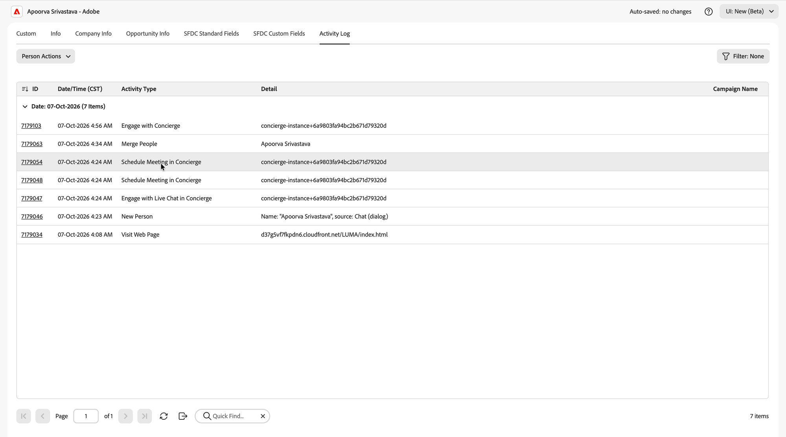

# Marketo Engage中的Brand Concierge数据 {#marketo-activities}

当[!DNL Adobe Marketo Engage]连接时，填写表单、预订会议或开始实时聊天的所有访客都将在[!DNL Marketo]中成为个人记录，并且其门房参与将作为本机活动类型写入该记录。 这意味着您可以根据门房行为构建智能列表和智能营销活动，就像在任何其他[!DNL Marketo]活动上一样。

>[!NOTE]
>
>Live Chat和会议预订本身不需要[!DNL Marketo Engage]。 如果不使用它，此页面上描述的数据将保留在[!DNL Adobe Marketo Qualifier]中。 查看[Live Chat和会议预约概述](overview.md#prerequisites)。

## 潜在客户创建和来源归因 {#lead-creation}

通过门房创建的人会被标记，以便您始终能够分辨其来源。

| 字段 | 值 |
| --- | --- |
| **[!UICONTROL 人员Source]** | `Brand Concierge` |
| **[!UICONTROL 原始Source类型]** | `Chat` |
| **[!UICONTROL 原始Source信息]** | `Concierge` |
| **[!UICONTROL 注册Source类型]** | `Chat` |
| **[!UICONTROL 注册Source信息]** | `Concierge` |

{width="800" zoomable="yes"}

## 活动类型 {#activity-types}

将三种本机活动类型推送到人员记录。 这三种方法都可用作触发器和过滤器。

{width="800" zoomable="yes"}

### 与礼宾部接洽 {#engage-with-concierge}

当访客与门房互动时记录。

| 属性 | 说明 |
| --- | --- |
| 礼宾名称 | 访客参与的服务台 |
| 对话ID | 对话的标识符。 在Composer中使用它可打开完整成绩单 |
| Page URL | 预订发生的页面 |
| 创建于 | 创建对话的时间 |
| 持续时间 | 对话持续了多长时间 |

>[!NOTE]
>
>此活动类型中的某些属性（包括讨论的主题、摘要和语言）尚未填充。 计划在将来的版本中发布它们。

### 在礼宾处安排会议 {#schedule-meeting}

为单次预订记录了&#x200B;**两次**，这使您可以将意图与结果分开。

**首先，启动时。** 访客选择了安排会议的选项，此时会显示预订表单。 会议状态为`Started`。

| 属性 | 说明 |
| --- | --- |
| 会议状态 | `Started` |
| Page URL | 访客启动预订的页面 |
| 礼宾ID | 访客参与的服务台 |
| 人员 ID | [!DNL Marketo]个人记录 |

**然后，在预订时。** 访客确认了插槽。 会议状态为`Scheduled`。

| 属性 | 说明 |
| --- | --- |
| 会议状态 | `Scheduled` |
| 销售代表姓名 | 预订会议的代表 |
| 销售代表电子邮件 | 代表的电子邮件地址 |
| 计划对象 | 会议的日期和时间 |
| 会议持续时间 | 预订会议的长度 |
| 路由类型 | 解析此代表的日历的路由 |
| Page URL | 访客预订的页面 |
| 礼宾ID | 访客参与的服务台 |
| 人员 ID | [!DNL Marketo]个人记录 |

>[!TIP]
>
>在`Meeting Status`上生成智能列表为`Started`，但不是`Scheduled`，以查找已开始预订会议并放弃该会议的每个人。 这是一个现成的培养或者重新定位的观众。

### 在礼宾部参与实时聊天 {#engage-with-live-chat}

在实时聊天结束后记录。

| 属性 | 说明 |
| --- | --- |
| 对话状态 | `Ended`如果聊天被有意关闭，`Dropped`如果访客离开网站且聊天超时 |
| 已通知的代理 | 每个收到此聊天通知的座席的电子邮件地址 |
| 对话得分 | 代表进行了交谈，打了0到3分。 查看[为对话评分](chat-inbox.md#conversation-score) |
| Page URL | 启动实时聊天的页面 |
| 礼宾ID | 访客参与的服务台 |
| 会话ID | 实时聊天会话标识符 |
| 开始时间 | 聊天开始的时间 |

>[!TIP]
>
>对话分数是此处值最高的属性，因为实际与访客交谈的人设置了对话分数。 将其用于潜在客户评分、重新定位、个性化，以及移交给销售人员和CRM。

## 在Smart Campaign中使用礼宾数据 {#smart-campaign}

在Smart Campaign的&#x200B;**[!UICONTROL 智能列表]**&#x200B;中，搜索`concierge`以查看所有可用内容。

{width="800" zoomable="yes"}

| 类别 | 可用项目 |
| --- | --- |
| **[!UICONTROL 触发器]** | 与门房合作，与门房进行实时聊天，安排在门房开会 |
| **[!UICONTROL 筛选器]** >活动历史记录 | 参与礼宾、参与礼宾中的Live Chat、在礼宾中的预定会议 |
| **[!UICONTROL 筛选器]** >非活动筛选器 | 未与礼宾处接触，未参与礼宾处的Live Chat，未安排在礼宾处举行的会议 |

将触发器或筛选器拖到画布上，然后选择&#x200B;**[!UICONTROL 添加约束]**&#x200B;以缩小其范围。

### 约束 {#constraints}

| 触发器或过滤器 | 约束 |
| --- | --- |
| 与礼宾部订婚 | 礼宾名称、页面URL、创建时间、持续时间、活动日期 |
| 预订的礼宾会议 | 礼宾姓名、销售代表姓名、会议状态、预定时间、会议持续时间、路由类型、页面URL、活动日期 |
| 在礼宾部参与实时聊天 | 礼宾姓名、销售代表姓名、对话状态、对话得分、开始时间、接受时间、结束时间、关闭者、持续时间、讨论主题、页面URL、语言、活动日期 |

## 下一步 {#next}

在[监视会议和实时聊天](monitor.md)中查看会议和聊天的执行情况。
