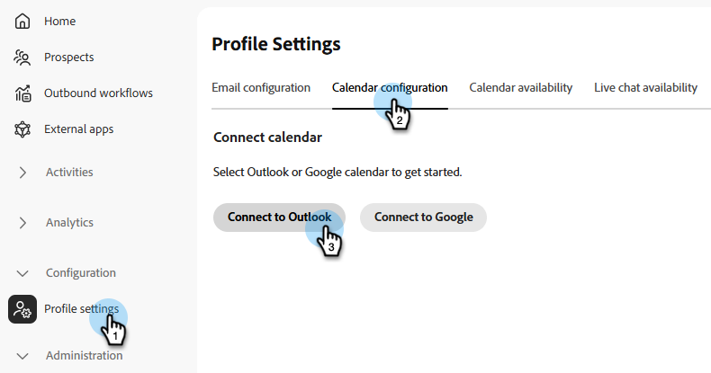
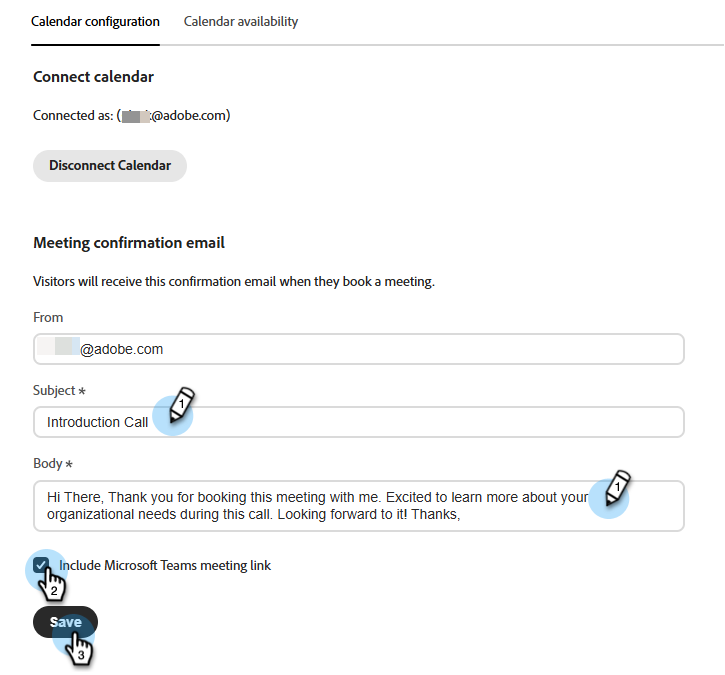
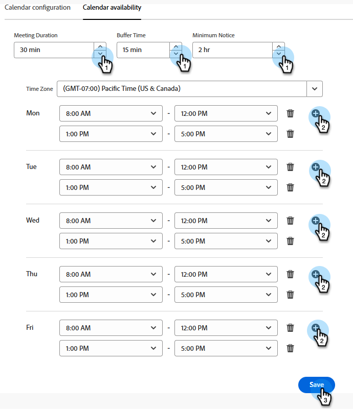

# 在Adobe Marketo Qualifier中设置代表 {#representative-setup}

在门房提供会议或实时聊天之前，必须在[!DNL Adobe Marketo Qualifier]中设置至少一名代表。 每个代表在自己的个人资料中执行一次此操作。

顺序是：管理员添加用户，然后每个代表连接日历，写入其确认电子邮件，并声明他们何时可用于会议和聊天。

## 将用户添加到组织 {#add-users}

管理员将每个销售代表添加为[!DNL Adobe Admin Console]中的用户，并授予他们对[!DNL Adobe Marketo Qualifier]的访问权限。 有关常规过程，请参阅[将用户添加到组织](../user-and-access-management/add-a-user-to-the-org.md)和[将用户添加到角色](../user-and-access-management/add-a-user-to-the-role.md)。

代表们自己完成其余步骤。

## 连接日历 {#connect}

日历连接使礼宾员能够看到真正的可用性。 如果没有此项，该代表将没有资格预订会议。

1. 登录到[Adobe Experience Cloud](https://experience.adobe.com/){target="_blank"}并选择&#x200B;**[!UICONTROL Adobe Marketo Qualifier]**。

   带有Adobe Marketo Qualifier卡的{width="800" zoomable="yes"}

1. 在左侧面板的&#x200B;**[!UICONTROL 配置]**&#x200B;下，选择&#x200B;**[!UICONTROL 配置文件设置]**，然后打开&#x200B;**[!UICONTROL 日历配置]**&#x200B;选项卡。

1. 选择要连接的日历： [!DNL Microsoft Outlook]或[!DNL Google Calendar]。

   {width="600" zoomable="yes"}

1. 使用现有帐户登录或添加新帐户，并授予所请求的权限。

   日历连接期间显示的{width="600" zoomable="yes"}

1. 查看访客在为您预订会议时收到的确认电子邮件。

   为您设置了默认主题行和正文。 编辑任一项，并选择是否在邀请中包含[!DNL Microsoft Teams]会议链接。

   {width="600" zoomable="yes"}

1. 选择&#x200B;**[!UICONTROL 保存]**。

## 设置日历可用性 {#calendar-availability}

连接日历可告知[!DNL Adobe Marketo Qualifier]您何时在&#x200B;*忙*。 日历可用性告知您&#x200B;*愿意*&#x200B;参加会议的时间。 两者都适用。

1. 在&#x200B;**[!UICONTROL 配置文件设置]**&#x200B;中，打开&#x200B;**[!UICONTROL 日历可用性]**&#x200B;选项卡。

   在设置任何可用性之前{width="600" zoomable="yes"}

1. 设置会议规则。

   | 设置 | 它控制的内容 |
   | --- | --- |
   | 会议持续时间 | 已预订的会议运行的时长，以及所提供的每个空位的长度 |
   | 缓冲时间 | 从一次会议结束到下一次会议开始之间的强制间隔 |
   | 最低通知 | 访客必须提前多久预订。 例如，设置4小时以阻止访客预订将在10分钟后开始的时段 |
   | 时区 | 可用小时数的时区。 访客始终会看到转换为自己时区的版块 |

1. 设置一周中每一天的可用小时数。

   一天可以是一个连续的块，例如上午8:00到下午5:00，也可以是多个块，例如上午8:00到下午12:00以及下午2:00到下午5:00。 将某一天留空，以便在该天不举行会议。

   >[!NOTE]
   >
   >若要将另一时间段添加到一天中，请选择加号（）。

   {width="600" zoomable="yes"}

1. 选择&#x200B;**[!UICONTROL 保存]**。

### 插槽如何变为可预订状态 {#slot-logic}

只有当某个时段在全部三项检查中存活下来时，才会向访客提供该时段：

1. 它落在您在此处设置的可用小时数内。
1. 该资源尚未被您的连接日历中的事件占用。 现有的9:00 AM会议将删除9:00 AM时段。
1. 它满足您最短通知和缓冲时间。

## 设置实时聊天可用性 {#chat-availability}

实时聊天可用性与日历可用性是分开的。 代表可以聊天，但不参加会议，反之亦然。

1. 在&#x200B;**[!UICONTROL 配置文件设置]**&#x200B;中，打开&#x200B;**[!UICONTROL 实时聊天可用性]**&#x200B;选项卡。

1. 设置您的时区，然后设置您愿意接收实时聊天的日期和时间。 周末也可包括在内。

   {width="600" zoomable="yes"}

1. 选择&#x200B;**[!UICONTROL 保存]**。

>[!NOTE]
>
>可用小时数使您&#x200B;*符合*&#x200B;的聊天资格。 您在聊天收件箱中的实时状态将决定您现在是否收到这些邮件。 查看[聊天收件箱](chat-inbox.md)。

## 查看已设置的人员 {#manage-members}

本节仅适用于管理员。 在&#x200B;**[!UICONTROL 管理]**&#x200B;下，选择&#x200B;**[!UICONTROL 管理成员]**&#x200B;可查看同一位置中每个代表的状态：已连接日历、已设置实时聊天可用性以及已断开日历连接。

在编辑器中激活集成之前，请使用此项。 此处显示但没有连接日历的代表没有资格进行会议预订，没有实时聊天功能的代表也没有资格进行实时聊天。

{width="800" zoomable="yes"}

## 下一步 {#next}

在至少设置了一个代表的情况下，确定访客与代表的匹配方式。 查看[将对话路由到代表](routing-rules.md)。
